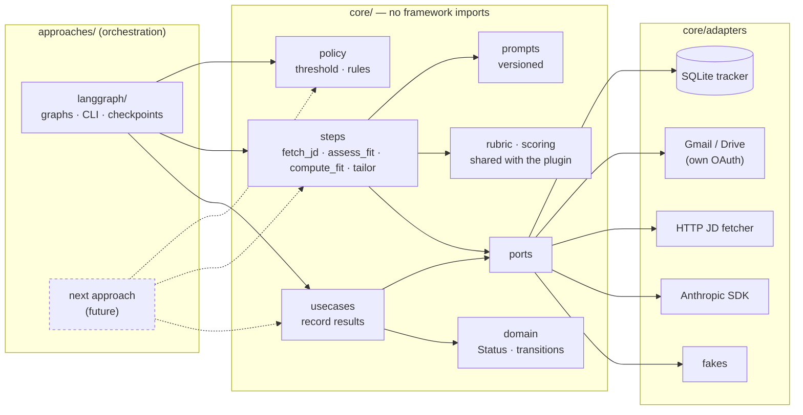
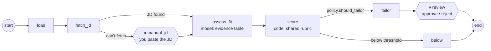

# Job-search orchestration

The job-search workflow as a code-defined pipeline, and a worked example of how to structure an agentic workflow: business logic in one framework-free package, orchestration in replaceable approaches, evals in CI, and a migration path from the version already in production.

Stated precisely, it is **LangGraph orchestration of headless Claude agents, with deterministic control flow**: code owns the route, state, checkpoints, human review and the tracker, and the model works inside steps. Agent steps reuse Anthropic's agent loop rather than implementing one; today every step is code or a single structured call, and agent steps are roadmap milestone 9 ([what B is](../../docs/roadmap.md#what-b-is-stated-precisely)).

**Setup:** [docs/setup/job-search-langgraph.md](../../docs/setup/job-search-langgraph.md) · **Why it's built this way:** [ADR 0001](../../docs/adr/0001-orchestration-approach.md), [ADR 0002](../../docs/adr/0002-tracker-is-system-of-record.md)

```bash
uv sync --all-packages && uv run jobs demo     # see it work with fakes, no keys needed
```

## What it does

1. **Intake:** find job leads in Gmail and screen them quickly: `jobs run intake`. The model reads each alert email's job cards; code dedups them and the rubric gives each a Tier 1 score. *(Gmail into the local tracker or B's shadow Google Sheet, deduped against the plugin's tracker: done)*
2. **Evaluate:** fetch the full job description; the model fills an evidence table (each requirement judged against the full resume, plus title fit and work arrangement against the job-search profile), and the shared rubric computes the 1–10 score with a readable breakdown ([ADR 0003](../../docs/adr/0003-shared-rubric.md)). Also names up to three gaps.
3. **Tailor:** for scores of 7 or more, draft a tailored resume and pause for the user's review. Re-tailor unsubmitted resumes when the full resume changes. *(tailor and review: done; re-tailoring: later)*
4. **Track:** follow each job through submission, interviews, and outcome, and notice when postings close. *(manual commands: done; automated sweep: later)*

## Architecture



**The evaluate graph.** Each job runs on its own checkpointed thread (`thread_id = job_id`). The model never produces the score: `assess_fit` returns judgments only, and `score` computes the number with the rubric, so a checkpoint sits between the paid call and the arithmetic:



### Rules the structure enforces

- **`core` never imports an orchestration framework.** [`test_import_boundary.py`](core/tests/test_import_boundary.py) fails CI if it does.
- **Routing decisions live in `core.policy`.** Graph edges only call the rules; they never re-implement them.
- **Status changes go through `tracker.transition()`.** It rejects illegal moves (for example, `below_threshold → submitted`) and records who made each change.
- **Steps that need a person return `NeedsHuman`.** Core doesn't decide how to wait: LangGraph uses `interrupt()`, and another approach can choose its own way.
- **No personal data in the repo.** `data/` is gitignored, and evals use a synthetic candidate.

## Layout

```
orchestration/job-search/
├── core/                       job_search_core — the business logic
│   ├── src/job_search_core/
│   │   ├── domain.py           Job, FitResult, EvidenceTable, LeadCard, Status, transitions
│   │   ├── policy.py           FIT_THRESHOLD, should_tailor, mail_window, find_duplicate, ...
│   │   ├── rubric.py           the fit rubric: an exact copy of the plugin's score.py (ADR 0003)
│   │   ├── scoring.py          score_evidence: EvidenceTable → RubricScore via the rubric
│   │   ├── canonical_url.py    the dedup key: an exact copy of the plugin's canonical_url.py
│   │   ├── steps.py            read_alert_email (model), tier1_fit (rubric), fetch_jd, assess_fit (model), compute_fit (rubric), tailor_resume
│   │   ├── profile.py          the job-search profile: scoring sections, email sources, never-scan
│   │   ├── usecases.py         record each result in the tracker
│   │   ├── ports.py            interfaces the steps depend on
│   │   ├── prompts/            versioned prompt files
│   │   └── adapters/           sqlite and Sheets trackers, known jobs, HTTP fetcher, Anthropic, Gmail, Google auth and Picker, fakes
│   └── tests/
├── approaches/
│   └── langgraph/              job_search_langgraph — evaluate and intake graphs, CLI (`jobs`), Studio entry
├── evals/job-fit/              synthetic persona (resume + profile), 8 labeled JDs, results/latest.json
├── evals/intake/               the plugin's intake case through the intake graph; results/latest.json
├── evals/comparison/          A (plugin) vs B (this pipeline) on the plugin's gold cases; results/RESULTS.md
└── data/                       gitignored: your resume and profile, tracker.db, checkpoints, google/ (OAuth client, token, the shadow's ID)
```

## Roadmap

The repository's north star is [`docs/roadmap.md`](../../docs/roadmap.md), which compares this pipeline with the Claude skills plugin and a local MCP server. Its milestone 3, scoring through the shared rubric, is done, and so is milestone 5, the measured comparison with the plugin ([`evals/comparison/`](evals/comparison/README.md)). The table below maps the pipeline's features to it.

| What | Status | Roadmap milestone |
|---|---|---|
| Core, evaluate graph, CLI, evals, CI, setup guide | ✅ | 1 |
| Scoring through the shared rubric | ✅ | 2, 3 |
| Measured comparison with the plugin | ✅ | 5 |
| Intake graph (Gmail), the Google Sheet as tracker, Tier 2 started from the Sheet, **shadow mode** next to the plugin | in progress | 6 |
| Agent nodes: headless Claude for intake and JD lookup, inside the graph | planned | 9 |
| Local app: one page over the graphs through a run API | planned | 8 |
| Hosted service on a subscription | strawman | stretch |
| Status sweep (closed postings, recruiter replies), re-tailoring when the full resume changes | later | — |
| `.docx` resume rendering, per-call LLM tracing | later | — |

## Development

```bash
uv sync --all-packages
uv run pytest -q                                  # unit + graph tests, all fakes
uv run ruff check . && uv run ruff format --check .
uv run python evals/job-fit/run_evals.py          # real model; needs ANTHROPIC_API_KEY
uv run python evals/intake/run_evals.py --runs 3  # intake on the plugin's intake case; real model
uv run python evals/comparison/run_b.py --runs 3  # the comparison: B's side (A's runs in WSL; see its README)
```
